<div align="center">



<h1 align="center">MALLARDED</h1>

[](https://git.io/typing-svg)

<br/>

<a href="https://github.com/nritter26?tab=repositories">
  
</a>

<br/>

</div>

---

## 🧠 About Me

```go
package main

import "fmt"

type Engineer struct {
	Age               int
	Citizenship       []string
	Location          string
	Role              string
	Specialties       []string
	CurrentlyBuilding string
}

func main() {
	mallarded := Engineer{
		Age:         29,
		Citizenship: []string{"Swiss", "Thai"},
		Location:    "Bangkok, Thailand",
		Role:        "Backend & Systems Engineer",
		Specialties: []string{
			"Go (Golang) Backend & Distributed Systems",
			"TypeScript Full-Stack & Event-Driven Architecture",
			"Bare-Metal DevSecOps & Self-Hosting Lab",
		},
		CurrentlyBuilding: "Multi-Exchange Arbitrage Order Book Aggregator & Cloud Lab",
	}

	fmt.Printf("%+v\n", mallarded)
}
```

---

## 🛠️ Tech Stack

<div align="center">


</div>

---

## ⏱️ Coding Activity

<div align="center">


</div>

---

## 📊 GitHub Stats

<div align="center">


<br/>


</div>

---

## 📈 Contribution Graph

<div align="center">


</div>


